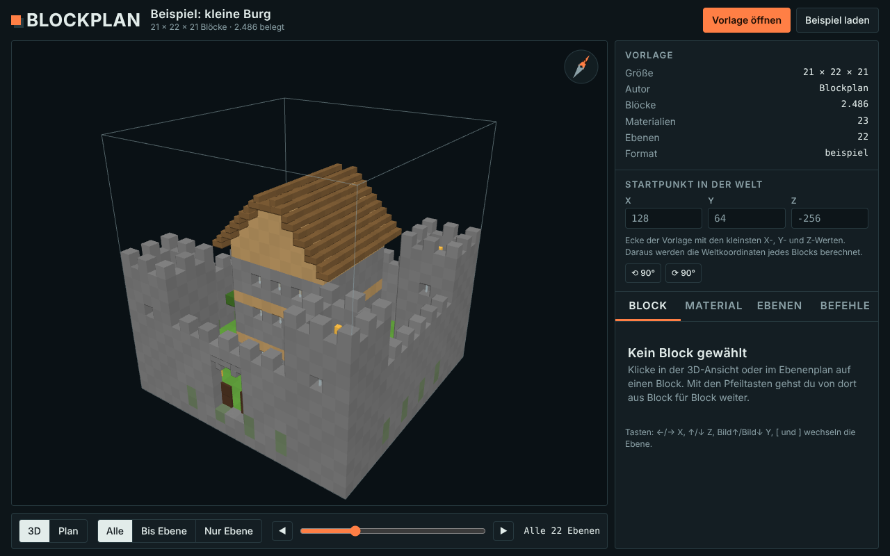

# Blockplan

**View Minecraft build templates in 3D, compare them live against your world, and build them block-perfect.**

Blockplan is a small local tool for Minecraft Java Edition. Load a template (`.litematic`, `.schem`, `.nbt`), explore it in 3D and as a layer plan with exact coordinates and a material list, and compare it every 10 seconds with the world you are playing. It can also generate merged `/fill` commands or a ready-made data pack.

[Deutsche Version](README.md)



## Features

- **Templates:** `.litematic` (Litematica), `.schem` (Sponge v2/v3, WorldEdit), `.nbt` (structure blocks). Drag & drop or file dialog.
- **3D view and layer plan:** orbit/zoom, show all / up to / only one layer, click a block for name, properties and world coordinates.
- **Materials:** full list with counts, stacks and shulker boxes; tick off, search, highlight.
- **Live compare:** reads your world files directly and marks each block as *done*, *wrong* or *missing*; progress in percent, per-layer completion, "still missing" material list.
- **World surroundings:** shows the terrain around the template; click the ground to set the origin; Shift + arrow keys nudge the template block by block.
- **Rotate:** 90° / 180° / 270°; block properties (`facing`, `axis`, `rotation`, fence connections) rotate along.
- **Commands:** merged `/fill` and `/setblock` commands, optionally only for missing/wrong blocks, exported as a data pack (`.mcfunction`).
- **Version aware:** reads the data pack format and block list of your game version from the Minecraft jar, renames renamed blocks (`chain` → `iron_chain`) and skips unknown ones.
- **Diagnostics:** "search game log for errors" shows data pack problems inside Blockplan.

Everything runs locally. Nothing is uploaded.

## Requirements

- Minecraft Java Edition. Tested with 26.3 (Fabric, Modrinth App, Windows 11, singleplayer).
- Node.js 18+ (LTS from <https://nodejs.org>).
- A current browser. For commands/data packs, cheats must be enabled in the world.

## Installation

**Option A: release package (recommended)**

1. Download `blockplan-live-<version>.zip` from the repository's *Releases* page and unzip it.
2. Windows: double-click `start.bat`. macOS/Linux: `chmod +x start.sh && ./start.sh`.
3. Your browser opens `http://localhost:8765`. Keep the window open; stop with `Ctrl+C`.

**Option B: from source**

```bash
git clone https://github.com/<your-name>/blockplan.git
cd blockplan
npm ci
npm start      # builds and starts the server on http://localhost:8765
```

`npm run release` creates the release ZIP in `dist/`.

Without the server (`dist/index.html` opened directly) you can view templates, materials and copy commands. Live compare, surroundings and writing the data pack need the local server because browsers cannot read your world files.

## Quick start

1. Open a template (or click "Beispiel laden" for the sample castle).
2. Enter the **origin**: the corner with the *smallest* X, Y and Z where the template should stand (press `F3` in game).
3. Pick your world under "Live-Abgleich". Worlds are found automatically in `.minecraft`, the Modrinth App and Prism Launcher.
4. Build. Minecraft only writes the world on save, so use `/save-all` (cheats) to force it.

## Commands and data pack

1. Tab **Befehle** → choose scope (all / visible layers, whole template / only missing/wrong, optional clear area first) → **In Welt schreiben** (writes `<world>/datapacks/blockplan`) or download the ZIP and put it into the world's `datapacks` folder.
2. In game, stand in the **middle of the build area** (chunks must be loaded), run `/reload`, optionally `/datapack list` and `/function blockplan:test`.
3. Run `/function blockplan:build_001`. If there are several files, run **all of them in order**.

> **Warning:** "clear area first" deletes everything inside the template's volume, including terrain and trees. **Back up your world first.**

## Options

```bash
node server.js                                   # auto-detect saves folders
node server.js "C:\path\to\saves\MyWorld"        # preselect a world
node server.js --saves "C:\a\saves;D:\b\saves"   # custom folders, separated by ;
node server.js --port 8766                       # different port
```

## Security and privacy

- The server listens on `127.0.0.1` only.
- It reads your world. It writes only when you click "In Welt schreiben", and only to `<world>/datapacks/blockplan`; file names are whitelisted and cross-origin requests are rejected.
- The log is read only on button click and filtered to Blockplan/function lines.
- No data is sent to third parties. The page loads fonts from Google Fonts; offline it falls back to system fonts. Remove the `fonts.googleapis.com` link in `src/app.html` to avoid this.

## Troubleshooting

| Problem | Fix |
|---|---|
| `Unknown function 'blockplan:build_001'` | The data pack is loaded but a line is invalid. Click **Fehler im Spiel-Log suchen** in the Befehle tab to see which block was rejected. |
| `Unknown function 'blockplan:test'` | Data pack not loaded: `/reload`, check `/datapack list`, `/datapack enable "file/blockplan"`; make sure it is in the world you are playing. |
| Data pack incompatible | Adjust `min_format` / `max_format` in `datapacks/blockplan/pack.mcmeta`. |
| World missing | Check which folders the server printed at startup; pass `--saves`. |
| "Unbekanntes Palette-Format im Chunk" | Your game uses a chunk format Blockplan does not know. Please open an issue with the message; `http://localhost:8765/api/diag?x=<X>&z=<Z>` shows the chunk structure without block data. |
| Everything "wrong"/"missing" | Check origin (smallest X/Y/Z, right dimension), run `/save-all`, try disabling "Ausrichtung vergleichen". |
| Port in use | `node server.js --port 8766`. |

## Known limitations

- Tested on Minecraft 26.3 (Fabric), Windows 11, singleplayer, with real `.litematic` files. Linux/macOS paths, Prism detection and other game versions are only tested with generated worlds.
- Legacy `.schematic` (pre-1.13) is not supported (convert with e.g. Amulet).
- Stairs, doors, fences etc. are drawn simplified in 3D.
- Live compare shows the **saved** world state, not the game's memory.
- Block renames between versions are only known for `chain` → `iron_chain`; other unknown blocks are skipped and listed.
- Block entities (chest contents, sign text) are not captured or built.
- Java Edition only.

## Development

```bash
npm ci
npm test         # unit/integration tests (Node only)
npm run test:ui  # browser tests; needs: npm i -D playwright && npx playwright install chromium
npm run release  # dist/blockplan-live-<version>.zip
```

Tests generate their own worlds and templates; no real saves are needed.

## License

[MIT](LICENSE). three.js (MIT) is bundled in releases. Blockplan is unofficial and not affiliated with Mojang or Microsoft. Templates are often copyrighted; respect the creator's terms.
