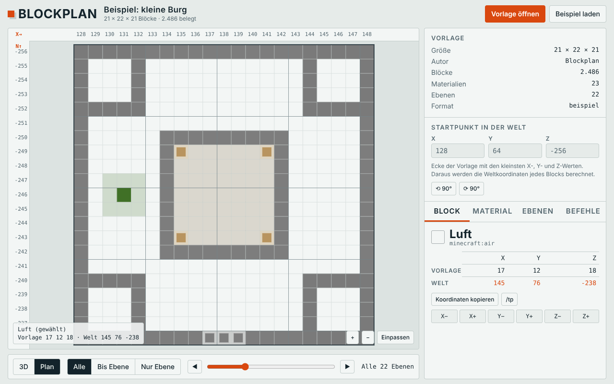
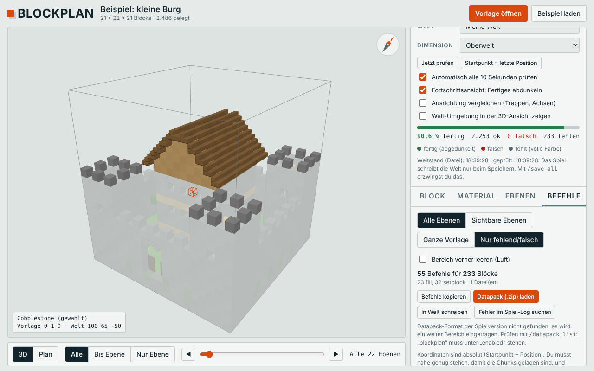
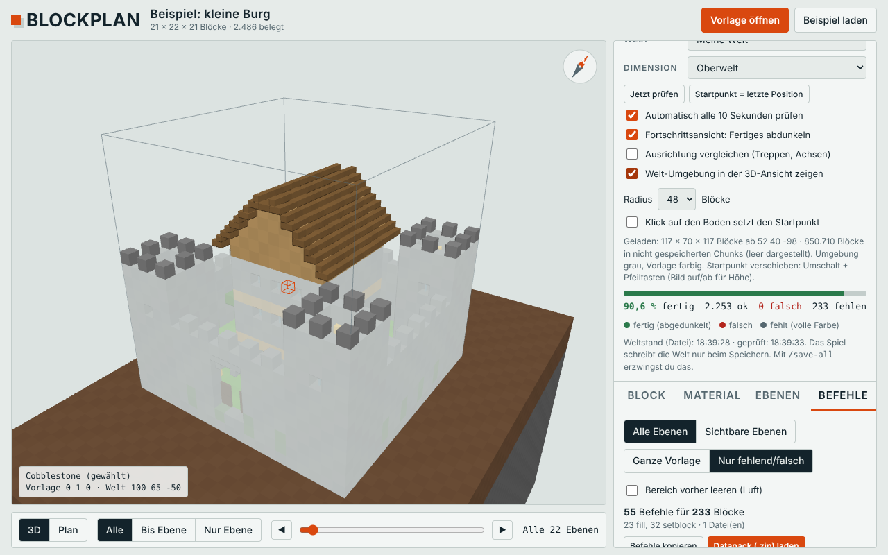

# Blockplan

**Minecraft-Vorlagen in 3D ansehen, live mit deiner Welt vergleichen und blockgenau nachbauen.**

Blockplan ist ein kleines lokales Werkzeug für Minecraft Java Edition. Du lädst eine Vorlage (`.litematic`, `.schem`, `.nbt`), siehst sie in 3D und als Ebenenplan mit exakten Koordinaten und Materialliste, und vergleichst sie alle 10 Sekunden mit der Welt, die du gerade spielst. Wer will, lässt sich daraus `/fill`-Befehle oder ein fertiges Datapack erzeugen.

[English version](README.en.md)


## Inhalt

- [Funktionen](#funktionen)
- [Voraussetzungen](#voraussetzungen)
- [Installation](#installation)
- [Erste Schritte](#erste-schritte)
- [Befehle und Datapack](#befehle-und-datapack)
- [Bedienung](#bedienung)
- [Welt-Ordner und Optionen](#welt-ordner-und-optionen)
- [Sicherheit und Datenschutz](#sicherheit-und-datenschutz)
- [Fehlerbehebung](#fehlerbehebung)
- [Bekannte Einschränkungen](#bekannte-einschränkungen)
- [Entwicklung](#entwicklung)
- [Lizenz und Hinweise](#lizenz-und-hinweise)

## Funktionen

| Bereich | Was es kann |
|---|---|
| **Vorlagen** | Liest `.litematic` (Litematica), `.schem` (Sponge v2 und v3, WorldEdit) und `.nbt` (Strukturblöcke). Per Datei-Dialog oder Drag & Drop. |
| **3D-Ansicht** | Drehen, Zoomen, Ebenen ein- und ausblenden (alle, bis Ebene, nur Ebene), Block anklicken für Name, Eigenschaften und Weltkoordinaten. |
| **Ebenenplan** | Draufsicht pro Ebene mit Koordinatenlineal, Zoom und Verschieben. |
| **Material** | Vollständige Liste mit Stückzahl, Stacks und Shulkerboxen. Abhaken, suchen, nach Art hervorheben. |
| **Live-Abgleich** | Liest deine Welt direkt aus den Dateien und zeigt pro Block *fertig*, *falsch* oder *fehlt*. Fortschritt in Prozent, pro Ebene automatisch abgehakt, Materialliste „Fehlt noch“. |
| **Welt-Umgebung** | Zeigt das Gelände um die Vorlage in der 3D-Ansicht. Klick auf den Boden setzt den Startpunkt. Umschalt + Pfeiltasten schiebt die Vorlage blockweise. |
| **Drehen** | Vorlage um 90°, 180°, 270° drehen. Blockeigenschaften wie `facing`, `axis`, `rotation` und Zaunverbindungen drehen mit. |
| **Befehle** | Erzeugt zusammengefasste `/fill`- und `/setblock`-Befehle, optional nur für Fehlendes und Falsches, als Datapack (`.mcfunction`). |
| **Versionsfest** | Liest Datapack-Format und Blockliste deiner Spielversion aus der Minecraft-Datei, benennt umbenannte Blöcke um (`chain` wird `iron_chain`) und überspringt unbekannte. |
| **Diagnose** | Knopf „Fehler im Spiel-Log suchen“ zeigt Datapack-Fehler direkt in Blockplan. |

Alles läuft lokal. Nichts wird hochgeladen.

### Screenshots

| Ebenenplan | Befehle | Welt-Umgebung |
|---|---|---|
|  |  |  |

Die Bilder zeigen die mitgelieferte Beispielburg.

## Voraussetzungen

- **Minecraft Java Edition**. Getestet mit Version 26.3 (Fabric, Modrinth App, Windows 11, Einzelspieler).
- **Node.js 18 oder neuer** (empfohlen: aktuelle LTS-Version von <https://nodejs.org>). Prüfen mit `node -v`.
- Ein aktueller Browser (Chrome, Edge, Firefox).
- Für Befehle und Datapack: In der Welt müssen **Cheats** aktiviert sein.

Blockplan hat zur Laufzeit keine weiteren Abhängigkeiten. three.js liegt im Paket.

## Installation

### Variante A: Fertiges Paket (empfohlen)

1. Auf der Seite **Releases** dieses Repositories die Datei `blockplan-live-<version>.zip` herunterladen.
2. ZIP entpacken, zum Beispiel nach `C:\Tools\blockplan-live`.
3. Starten:
   - **Windows:** Doppelklick auf `start.bat`.
   - **macOS / Linux:** Im Terminal in den Ordner wechseln und `chmod +x start.sh && ./start.sh` ausführen.
4. Der Browser öffnet `http://localhost:8765`. Das Fenster mit dem Server **offen lassen**. Beenden mit `Strg+C`.

Updates: Ordner löschen, neues ZIP entpacken. Deine Einstellungen (Startpunkt, Abhakliste) liegen im Browser und bleiben erhalten, solange du dieselbe Adresse benutzt.

### Variante B: Aus dem Quellcode

```bash
git clone https://github.com/dq7x/blockplan.git
cd blockplan
npm ci          # lädt nur three.js für den Build
npm start       # baut und startet den Server auf http://localhost:8765
```

Ein Release-ZIP erzeugst du mit `npm run release`. Es landet in `dist/`.

### Nur ansehen, ohne Installation

Die Seite `dist/index.html` (nach `npm run build`) lässt sich auch direkt im Browser öffnen. Dann funktionieren Vorlage laden, 3D-Ansicht, Material und Befehle kopieren (three.js kommt dabei aus dem Internet). **Live-Abgleich, Welt-Umgebung und Datapack schreiben brauchen den lokalen Server**, weil ein Browser deine Weltdateien nicht lesen darf.

## Erste Schritte

1. **Vorlage laden.** „Vorlage öffnen“ oder Datei ins Fenster ziehen. Zum Ausprobieren hilft „Beispiel laden“.
2. **Startpunkt eintragen.** Rechts unter „Startpunkt in der Welt“ die Koordinaten der Ecke, an der die Vorlage stehen soll. Gemeint ist die Ecke mit den **kleinsten** X-, Y- und Z-Werten. Im Spiel mit `F3` ablesbar. Alle Blockkoordinaten rechnet Blockplan daraus um.
3. **Welt wählen.** Unter „Live-Abgleich mit deiner Welt“ deine Welt auswählen. Gefunden werden Welten aus `.minecraft`, der Modrinth App und dem Prism Launcher. Wie die Liste entsteht, steht unter [Welt-Ordner und Optionen](#welt-ordner-und-optionen).
4. **Bauen.** Block anklicken, Koordinaten ablesen, in Minecraft setzen. Alle 10 Sekunden wird neu verglichen.
5. **Speichern nicht vergessen.** Minecraft schreibt die Welt nur beim Speichern auf die Festplatte (automatisch alle paar Minuten). Mit `/save-all` (Cheats nötig) erzwingst du es. Blockplan zeigt oben im Live-Bereich, von wann der Weltstand ist.

### Platzieren mit der Welt-Umgebung

Haken bei **Welt-Umgebung in der 3D-Ansicht zeigen**. Das Gelände erscheint grau, die Vorlage farbig. Dann:

- **Klick auf den Boden** (Haken bei „Klick auf den Boden setzt den Startpunkt“): Die Ecke der Vorlage landet auf dem angeklickten Block, die Unterkante direkt darüber.
- **Umschalt + Pfeiltasten** verschiebt den Startpunkt um einen Block (`Bild auf` und `Bild ab` für die Höhe).
- **⟲ 90° / ⟳ 90°** dreht die Vorlage, bevor du sie platzierst.

Die Umgebung zeigt den zuletzt gespeicherten Stand der Welt, nicht den Live-Stand.

## Befehle und Datapack

Im Tab **Befehle** erzeugt Blockplan aus der Vorlage Minecraft-Befehle:

- Gleiche Blöcke werden zu `/fill`-Quadern zusammengefasst (höchstens 32.768 Blöcke pro Befehl, das Standardlimit von Minecraft). Einzelne Blöcke werden zu `/setblock`.
- Erst die vollen Blöcke, dann Fackeln, Türen, Treppen und Ähnliches, damit der Halt schon steht.
- Optionen: alle oder nur sichtbare Ebenen, ganze Vorlage oder **nur fehlend/falsch** (mit Live-Abgleich), optional **Bereich vorher leeren**.
- Bei mehr als 30.000 Befehlen wird auf mehrere Dateien aufgeteilt (`build_001`, `build_002`, …), damit das Standardlimit von 65.536 Befehlen pro Ausführung nicht greift.

> **Achtung:** „Bereich vorher leeren“ löscht alles im Bereich der Vorlage, auch Gelände und Bäume. **Mach vorher ein Backup deiner Welt.**

### Ablauf im Spiel

1. In Blockplan im Tab „Befehle“ **In Welt schreiben** klicken. Das schreibt das Datapack nach `<Welt>/datapacks/blockplan`. Alternativ **Datapack (.zip) laden** und die ZIP ohne Entpacken in den Ordner `datapacks` der Welt legen.
2. Im Spiel in die **Mitte des Baugebiets** gehen. Blöcke in nicht geladenen Chunks setzt Minecraft nicht.
3. `/reload`
4. Optional prüfen: `/datapack list` zeigt `file/blockplan` unter „aktiviert“. `/function blockplan:test` gibt eine Testzeile im Chat aus.
5. `/function blockplan:build_001` ausführen. Bei mehreren Dateien **der Reihe nach alle** (`build_002`, `build_003`, …), sonst bleibt der Bau unvollständig. Die Knöpfe 001, 002, … im Tab kopieren den jeweiligen Befehl.
6. Danach im Tab „Befehle“ **Nur fehlend/falsch** wählen und prüfen, was noch fehlt.

Mit sehr großen Vorlagen (hunderttausende Blöcke) laufen die Dateien jeweils einige Sekunden. Das Spiel kann dabei kurz stehen bleiben.

## Bedienung

| Aktion | Eingabe |
|---|---|
| Ansicht drehen / verschieben / zoomen | Maus ziehen / Rechtsklick ziehen / Mausrad (Touch: ziehen, zwei Finger) |
| Block auswählen | Klick |
| Auswahl verschieben | Pfeiltasten (X/Z), `Bild auf` / `Bild ab` (Y) |
| Ebene wechseln | `[` und `]` |
| Startpunkt verschieben | `Umschalt` + Pfeiltasten, `Umschalt` + `Bild auf/ab` |
| Auswahl aufheben | `Esc` |

Die Seite hat ein helles und ein dunkles Design und folgt der Systemeinstellung. Sie funktioniert auch auf dem Handy.

## Welt-Ordner und Optionen

Blockplan sucht beim Start automatisch in diesen Ordnern nach `saves`:

| Launcher | Pfad |
|---|---|
| Standard | `%APPDATA%\.minecraft\saves` (Windows), `~/.minecraft/saves` (Linux), `~/Library/Application Support/minecraft/saves` (macOS) |
| Modrinth App | `…/ModrinthApp/profiles/<Profil>/saves` |
| Prism Launcher | `…/PrismLauncher/instances/<Instanz>/minecraft/saves` |

Beim Start gibt das Fenster aus, welche Ordner gefunden wurden. Bei mehreren Ordnern steht hinter jeder Welt das Profil.

Kommandozeile (`start.bat` und `start.sh` reichen alles durch):

```bash
node server.js                                   # automatische Suche
node server.js "C:\Pfad\zu\saves\MeineWelt"      # eine Welt gleich vorwählen
node server.js --saves "C:\Pfad\a\saves;D:\b\saves"   # eigene Ordner (mit ; getrennt)
node server.js --port 8766                       # anderer Port
```

Unterstützt werden Welten mit `region/`, `DIM-1/region`, `DIM1/region` und dem neueren Layout `dimensions/minecraft/<Dimension>/region`.

## Sicherheit und Datenschutz

- Der Server hört **nur auf `127.0.0.1`**. Er ist von anderen Rechnern im Netzwerk nicht erreichbar.
- Er **liest** deine Welt. Geschrieben wird ausschließlich auf Knopfdruck („In Welt schreiben“) und ausschließlich nach `<Welt>/datapacks/blockplan`. Dateinamen werden gegen eine feste Liste geprüft, Anfragen mit fremder Herkunft werden abgelehnt.
- Das Log wird nur auf Knopfdruck gelesen (`logs/latest.log` der Instanz) und nur auf Zeilen zu Blockplan und Funktionen gefiltert.
- Es werden keine Daten an Dritte gesendet. **Einzige Ausnahme:** Die Seite lädt ihre Schriftarten von Google Fonts. Ohne Internet fällt sie auf Systemschriften zurück. Wer das nicht will, entfernt den `<link>` auf `fonts.googleapis.com` in `src/app.html`.
- Vorlagen und Weltdaten bleiben auf deinem Rechner.

## Fehlerbehebung

| Problem | Lösung |
|---|---|
| `Unbekannte Funktion 'blockplan:build_001'` | Das Datapack ist geladen, aber eine Zeile in der Datei ist ungültig. Im Tab „Befehle“ auf **Fehler im Spiel-Log suchen** klicken. Dort steht, welcher Block abgelehnt wurde. Ein typischer Fall sind Blöcke, die es in deiner Version nicht gibt (zum Beispiel `chain`, seit 1.21.9 `iron_chain`). Blockplan benennt bekannte Fälle um und überspringt unbekannte, wenn es deine Spielversion findet. |
| `Unbekannte Funktion 'blockplan:test'` | Datapack nicht geladen. `/reload` ausführen und `/datapack list` prüfen. Steht `blockplan` unter „verfügbar“ statt „aktiviert“, `/datapack enable "file/blockplan"`. Prüfe auch, ob das Datapack in der Welt liegt, die du gerade spielst. |
| Datapack erscheint nicht oder „inkompatibel“ | Die Format-Nummer in `datapacks/blockplan/pack.mcmeta` passt nicht zur Version. Blockplan liest sie aus der Minecraft-Datei der Welt-Version. Findet es sie nicht (zum Beispiel bei einem unbekannten Launcher), trägt es einen weiten Bereich (88 bis 999) ein. Dann `min_format` und `max_format` von Hand anpassen. |
| Welt fehlt in der Liste | Beim Start im Fenster nachsehen, welche Ordner gefunden wurden. Eigenen Ordner mit `--saves` angeben. |
| „Unbekanntes Palette-Format im Chunk“ | Dein Minecraft speichert Chunks in einem Format, das Blockplan nicht kennt. Die Meldung enthält den rohen Eintrag. Bitte als Issue melden, mit dieser Zeile. Mit `http://localhost:8765/api/diag?x=<X>&z=<Z>` bekommst du die Chunk-Struktur ohne Blockdaten. |
| „Chunk-Kompression 4 wird nicht unterstützt“ | Die Welt nutzt LZ4-Kompression (Servereinstellung `region-file-compression`). Auf `deflate` stellen. |
| Alles ist „falsch“ oder „fehlt“, obwohl gebaut | Startpunkt prüfen (kleinste X/Y/Z der Vorlage, richtige Dimension). Weltstand prüfen: Minecraft muss gespeichert haben (`/save-all`). „Ausrichtung vergleichen“ ausschalten, wenn nur Richtungen abweichen. |
| Umgebung zeigt Lücken | Das sind Chunks, die noch nie gespeichert wurden. Sie werden leer dargestellt und vom Live-Abgleich als „unbekannt“ gezählt. |
| Befehle bauen nur einen Teil | Alle `build_*`-Dateien der Reihe nach ausführen, in der Mitte des Gebiets stehen (Chunks geladen), Cheats aktiv. |
| Port belegt | `node server.js --port 8766` und `http://localhost:8766` öffnen. |
| Seite zeigt keinen Live-Bereich | Die Seite muss über `http://localhost:8765` geöffnet sein, nicht als Datei. |
| `node` nicht gefunden | Node.js LTS installieren und das Fenster neu öffnen. |

## Bekannte Einschränkungen

- Getestet wurde mit Minecraft 26.3 (Fabric) unter Windows 11, Einzelspieler, mit echten `.litematic`-Vorlagen. Linux- und macOS-Pfade, Prism-Launcher-Erkennung und andere Minecraft-Versionen sind nur mit nachgebauten Testwelten geprüft.
- Das alte `.schematic`-Format (vor 1.13, MCEdit) wird nicht unterstützt. Konvertiere solche Dateien zum Beispiel mit dem Programm Amulet.
- Treppen, Türen, Zäune und ähnliche Formen werden in 3D vereinfacht dargestellt. Maßgeblich sind Blockname und Eigenschaften im Infofeld.
- Der Live-Abgleich zeigt den **gespeicherten** Stand der Welt, nicht den Arbeitsspeicher des Spiels.
- Block-Umbenennungen zwischen Versionen sind nur für bekannte Fälle hinterlegt (`chain` → `iron_chain`). Andere unbekannte Blöcke werden übersprungen und aufgelistet.
- Blockdaten wie Truhen-Inhalte, Schilder-Text und Block-Entitäten werden nicht erfasst oder gebaut. Es geht um Blöcke und ihre Zustände.
- Nur Java Edition. Bedrock wird nicht unterstützt.
- Mehrspieler-Server: Der Live-Abgleich liest Dateien, die der Server schreibt. Das ist nur sinnvoll, wenn der Server auf demselben Rechner läuft.

## Entwicklung

```
src/app.html          Oberfläche (HTML, CSS, JS in einer Datei, Platzhalter für den Kern)
src/core.js           Kern: NBT, Formate, Mesh, Picking, Material, Befehle, Drehen, ZIP
server/server.js      lokaler HTTP-Server
server/anvil.js       Anvil-Leser (Regionen, Chunks), Versions-Erkennung, Log-Filter
release-files/        liegt dem Release-ZIP bei (Start-Skripte, Kurz-README)
scripts/release.js    erzeugt das Release-ZIP
test/                 Tests
build.js              baut dist/ (Viewer, Paket dist/blockplan-live)
```

```bash
npm ci               # three.js (nur für den Build)
npm run build        # dist/index.html und dist/blockplan-live
npm start            # bauen und starten
npm test             # Unit- und Integrationstests (nur Node)
npm run test:ui      # Browser-Tests, braucht: npm i -D playwright && npx playwright install chromium
npm run release      # dist/blockplan-live-<version>.zip
```

Die Tests erzeugen ihre Welten und Vorlagen selbst (`test/world.js`, `test/fixture.js`), es werden keine echten Spielstände benötigt. Für die UI-Tests kannst du mit `CHROMIUM_PATH` einen vorhandenen Browser angeben.

Beiträge sind willkommen. Besonders hilfreich sind Meldungen zu anderen Minecraft-Versionen, Launchern und Betriebssystemen, am besten mit der Meldung aus dem Fenster oder dem Log.

## Lizenz und Hinweise

- Lizenz: [MIT](LICENSE).
- three.js (MIT) liegt dem Release bei: <https://threejs.org>.
- Blockplan ist ein inoffizielles Werkzeug. Es steht in keiner Verbindung zu Mojang oder Microsoft. „Minecraft“ ist eine Marke von Mojang Synergies AB.
- **Backup:** Befehle und Datapack verändern deine Welt. Sichere sie vorher.
- Vorlagen sind oft urheberrechtlich geschützt. Beachte die Bedingungen des Erstellers, besonders wenn du Bauten veröffentlichst.
